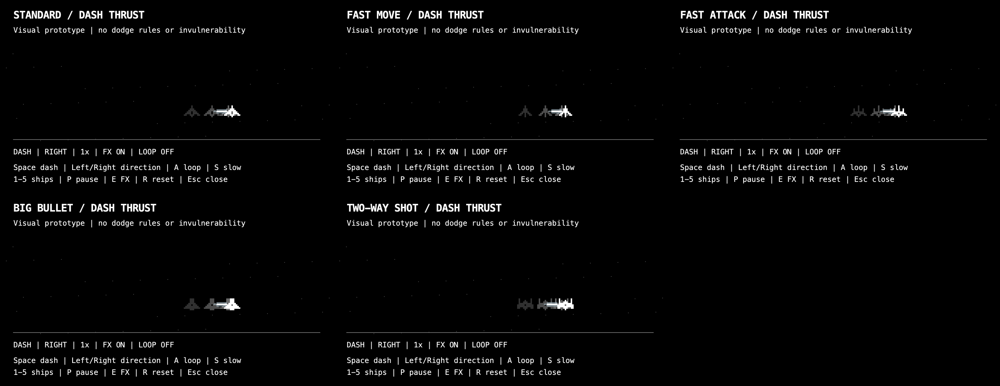

# Five-ship dash motion study

Design-only preview for DES-6. Uses the five approved 13 x 8 ship silhouettes at
the game's two-pixel scale. No gameplay, save files, purchases, collision rules,
invulnerability, cooldowns, or existing GhostTrail code are changed.

## Run (JDK 17 or later)

From any directory, run `bash /absolute/path/to/SDP-23621/scripts/preview-dash.sh`.
The script compiles only the effect and preview into a temporary directory,
opens a separate window, and removes the temporary build when the window closes.

| Key | Action |
| --- | --- |
| 1 / 2 / 3 / 4 / 5 | Standard / Fast Move / Fast Attack / Big Bullet / Two-Way Shot |
| Space | Play one dash in the selected direction |
| Left / Right | Select direction while idle |
| A | Toggle automatic repeat |
| S | Toggle 0.25x slow motion |
| P | Pause/resume |
| E | Compare with effects disabled/enabled |
| R | Reset position and playback |
| Esc | Close preview |

## Art specification and handoff

- Proposed motion: 180 ms, 110 screen pixels, easing out. These are mock preview
  values for art review; the gameplay team owns actual dash duration and distance.
- Up to three ship copies, sampled every 30 ms. Each fades over 120 ms, starting
  at approximately 45% opacity. Copies use the supplied ship shape and color.
- Neutral gray thrust with a white core, extending opposite horizontal movement.
  A short 40 ms startup changes to alternating 30 ms thrust frames. Thrust stops
  immediately when the dash ends; the remaining afterimages fade naturally.
- The reusable effect accepts a sprite mask, so other ships need no new ghost art.
  All five ships share one implementation. Thrust attaches to the occupied hull
  pixels on the middle sprite row, preserving each ship's transparent padding.
  Switching ships clears old trails and resets position and playback.
- Feed `DashVisualEffect.update` monotonic simulation milliseconds, actual ship
  positions, dash state, direction (-1/+1), and skin color. Draw before the current
  ship via `draw(Graphics2D, spriteMask)`. Reset on teleport, death or screen change.
- Pause by freezing simulation time. Integration into GameScreen/DrawManager and
  synchronization with the owning team's dash state remain a separate step.

## Verification

Compile the two preview sources and `tests/DashVisualEffectTest.java`, then run
`java -Djava.awt.headless=true -cp <classes> DashVisualEffectTest`.
The tests cover sampling across frame rates, bounded history, fading, thrust
orientation, graphics state, pause/reset, and direction changes without teleporting.
Use `bash scripts/preview-dash.sh --snapshot /absolute/path/preview.png` for a
five-ship comparison. `--smoke` opens, cycles through all five ships, plays their
dashes, and closes automatically.

Validated locally: 61 preview/effect checks, 367 existing regression checks,
Java 17 target compilation (six pre-existing warnings), and real-window smoke playback.

## Reference

