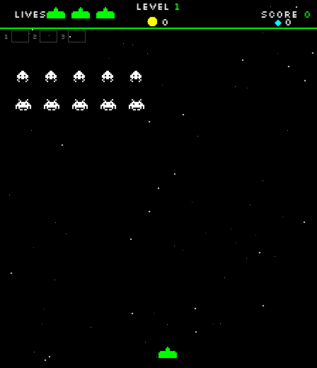

# Gameplay star background

GameScreen reuses Starfield's 70 stars and three downward scrolling layers
(0.2, 0.4 and 0.7 pixels per frame). Each level owns an independent instance;
TitleScreen's static background and its menu-return continuity are unchanged.
Restart retains the current background. A new level scatters a new background.

Stars update once per unpaused frame, including countdown and end transitions.
They are drawn immediately after initDrawing, before world shake, entities,
HUD, countdown, effects and pause overlays. Pause freezes the background;
resume continues from the same positions. No changes to DrawManager, Core,
TitleScreen or Starfield are needed.

## Automated verification

Run from the repository root with JDK 17+ and a graphical display. Linux CI
can prefix the integration command with `xvfb-run -a`. Build in an isolated
classes/save directory: FileManager stores saves beside the classes directory.

```sh
mkdir -p bin/starfield-check/classes
javac --release 17 -Xlint:all -d bin/starfield-check/classes $(find src tests -name '*.java')
java -cp bin/starfield-check/classes:res GameplayStarfieldTest
java -Djava.awt.headless=true -cp bin/starfield-check/classes:res TwoHitEnemyTest
java -Djava.awt.headless=true -cp bin/starfield-check/classes:res FinalBossAttackTest
java -Djava.awt.headless=true -cp bin/starfield-check/classes:res EffectIntegrationTest
```

Use a fresh directory for each run to avoid carrying test purchases forward.
The integration test accepts an optional existing output directory for PNGs.
It opens and closes a real game window and verifies 29 checks: title movement,
independent gameplay stars, countdown and active movement in levels 1/5/10,
visible background pixels, pause/resume, restart, title return and wraparound.
Existing suites pass 169, 125 and 71 checks respectively. Compilation has six
pre-existing warnings with JDK 25; no new warnings were introduced.

## Manual verification

1. Run `java -cp bin/starfield-check/classes:res engine.Core`.
2. Check title stars and menu navigation, then select Play.
3. Watch stars scroll behind the countdown, enemies, bullets and player.
4. Press P: stars freeze behind the pause menu. Resume: they continue.
5. Pause and Restart: gameplay resets while the background continues.
6. Return to the title; verify its menu and star background still work.


