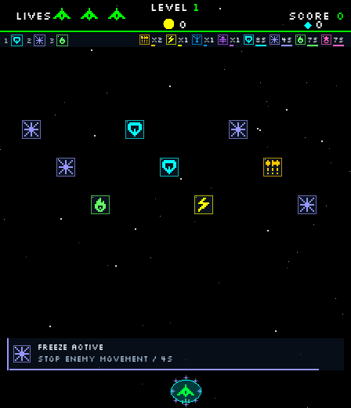
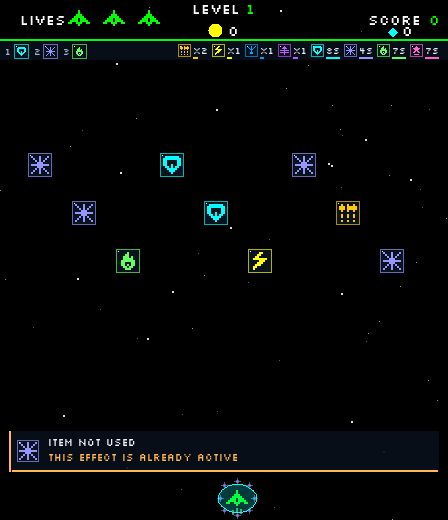

# 아이템 디자인·피드백 구현

담당 범위: 디자인팀 A 손동열. 현재 기준 코드: origin/main `0c5ac62`.
배경·우주선·게임 수치는 기존 구현을 사용한다.

## 변경 사항

- `ItemArtwork`: 13종의 9×9 픽셀 마스크. 바닥 드롭·슬롯·활성 효과·알림·튜토리얼에서 같은 아이콘을 사용한다. 9종 플레이 아이템 외 장비 4종의 그림도 제공하며, 상점 목록 자체는 변경하지 않는다.
- 기존 아이템 색을 유지하되 서로 다른 실루엣으로 구분한다. 네모와 첫 글자를 대체하며 외부 이미지 파일은 필요 없다.
- 550ms 획득 불꽃과 사용 시 확산 효과, 빙결의 눈송이, 활성 Boost의 추진 효과. 기존 방패 표현과 함께 사용한다.
- 최대 3개 알림과 8개 이펙트로 상태를 제한한다. 사용 알림은 오래된 획득 안내보다 먼저 표시하고, 실패 안내는 반복을 제한한다.
- 알림은 효과명·실제 사용 키·간단한 설명을 두 줄로 표시한다. 시간·스택·방어 횟수는 정의 및 실행 상태에서 읽는다.
- 상단 기존 아이템 영역(y=42~59)에 슬롯, 남은 초, 스택 수, 진행 막대를 표시한다. 448px 화면에서 슬롯 4개와 플레이 효과 8종이 함께 들어가며, 좁은 화면에서는 `+`로 추가 효과를 알린다.
- 꽉 찬 보관함에 닿았을 때, 빈 칸을 사용했을 때, 중복 적용이 거절됐을 때 원인을 안내한다. Shield/Boost/Score Boost의 기존 재사용 갱신 정책은 유지한다. Freeze 재사용은 기존 정책대로 거절한다.
- 일시정지 중 알림·효과 시간을 보존하고, 복귀 시 멈춘 벽시계 시간을 버린다. 드롭을 총알보다 먼저 그려 총알이 아이콘 뒤에 가려지지 않게 한다.

`ItemFeedback`은 이벤트 리스너를 사용한다. 화면을 그리는 동안 `drainEvents()`를 호출하지 않아 소리·도전과제 등 다른 소비자에게 전달할 이벤트를 보존한다.

## 로컬 검증 재현

프로젝트 폴더에서 Java 17 이상으로 실행한다. 저장 파일이 클래스 폴더 옆에 생기므로 사용자 데이터와 분리된 임시 폴더를 사용한다.

```sh
check_root=$(mktemp -d /tmp/sdp-item-check.XXXXXX)
mkdir -p "$check_root/classes"
javac --release 17 -Xlint:all -d "$check_root/classes" $(find src tests -name '*.java')
java -Djava.awt.headless=true -cp "$check_root/classes:res" item.ItemVisualFeedbackTest
```

창을 표시할 수 있는 환경에서는 실제 GameScreen 검증 및 PNG 저장도 실행한다.

```sh
java -cp "$check_root/classes:res" item.ItemVisualGameTest "$check_root/screenshots"
```

마지막 인자로 `--hold`를 붙이면 검증 마지막 화면을 45초 유지한다. 이 화면은 실제 게임 렌더러와 실제 아이템 API를 사용하되, 검증을 위해 아이템을 지급한 고정 상태다. 일반 플레이 조작 화면으로 사용하지 않는다.

기존 회귀 검사도 같은 클래스 경로로 실행한다. DashVisualEffectTest, EffectIntegrationTest, FinalBossAttackTest, TwoHitEnemyTest, WeaponUpgradeTest는 headless 모드, GameplayStarfieldTest는 창이 있는 환경을 사용한다. `res`를 클래스 경로에서 빼면 실제 스프라이트 대신 대체 그림이 로딩되므로 리소스 검사 결과가 달라진다.

## 확인 결과와 범위

2026-11-25 충돌 해결: 최신 main의 시간제 전투·보스 진행 및 기체별 탄환 설정을 병합했다. CI는 아이템 피드백 검사와 main의 게임 회귀 검사를 모두 유지한다. 일시정지 시계는 main의 `pauseClock()`으로 통일해 전투 타이머의 정지 처리와 함께 작동한다.

11월 21일 리뷰에서 발견된 `beginLevel`의 화면 높이 인자 누락 수정도 유지한다. CI build는 `src`와 `tests`를 함께 컴파일해 같은 API 불일치를 검출한다.

Java 17 대상 전체 소스·테스트 컴파일이 경고 없이 성공했고, 13개 테스트에서 894개 검증 항목이 통과했다. DashVisualEffect 61, EffectIntegration 77, FinalBoss 124, TwoHit 168, WeaponUpgrade 44, ShipVerticalMove 17, ShipDash 77, ShipStats 95, DashDodge 31, TimedRun 93, ItemVisualFeedback 55, GameplayStarfield 29, ItemVisualGame 23이다.

실제 GameScreen의 렌더링·일시정지 복귀 검사도 디스플레이 환경에서 재실행했다. 아래 화면 예시는 최초 구현 당시 생성한 것이며 새 게임 상태에서도 아이콘·HUD 표시를 확인했다. 키보드로 조작하는 수동 플레이 및 리뷰 승인 여부와는 구분한다.

공유 파일 수정: DrawManager(그리기 연결), GameScreen(일시정지 시계·드롭 순서), TutorialScreen(같은 아이콘과 안내 문구). PR 단계에서 해당 화면 담당자의 리뷰가 필요하다.

## 화면 예시

검증용 아이템 지급 상태에서 실제 게임 렌더러로 출력했다.






## Team Entities 변경 (2026-11-27)

- 획득 즉시 발동: Shield·Freeze·Boost·Score Boost는 잡는 순간 효과가 시작되고 슬롯에 들어가지 않는다. 같은 효과가 이미 켜져 있으면 시간을 처음부터 다시 센다(Freeze 포함, 위의 "Freeze 재사용 거절" 정책을 바꿈). `res/item-balance.properties`의 `pickup.autoUse=false`로 이전 방식(슬롯 + Z/X/C)을 되돌릴 수 있다. 직접 지급(`tryGrant`)은 지금도 슬롯에 넣는다.
- HUD는 빈 슬롯을 그리지 않는다. 슬롯에 아이템이 있을 때만 보인다.
- 하단 알림 패널을 그리지 않는다. `DrawManager.drawItemHud`가 `drawNotice`를 더 이상 호출하지 않으며, `ItemFeedback`의 알림 내용(`getNotice`)은 로그와 테스트용으로 그대로 계산한다.
- 드롭 확률 (2026-11-28): 처치당 드롭 15%→6%, 강화 아이템 가중치 1→1.8, 감소 0.7→0.55. `drop.upgradeDecay.shared=true`면 강화 아이템 가중치가 종류와 상관없이 지금까지 먹은 강화 아이템 총수만큼 줄어든다. 초반 한두 개는 쉽게 나오고 이후엔 드물다.
- 드롭 확률 분리 (2026-11-28): `drop.upgrade.probability`가 있으면 일반 적 처치 시 두 번 굴린다. 일반 아이템은 `drop.regular.probability`(6%), 강화 아이템은 `drop.upgrade.probability`(3.5%)에 감소율(0.65, 먹은 강화 총수 기준)을 곱한 확률. 한 번에 두 개가 나올 수도 있다.
- 총알 강화 (2026-11-28): 강화 아이템은 확산과 총알 강화(`bullet_power`, `EffectKind.BULLET_POWER`) 두 종류만 떨어진다. 총알 강화는 최대 6중첩이며 매 중첩 연사가 오르고(`bulletPower.fireBonus`, 연사와 같은 log2 곡선: +35/55/70/81/90/98%), `bulletPower.pierceEvery`(2)중첩마다 관통이 1 늘어난다(2·4·6중첩에서 관통 1·2·3). 연사·탄속·관통은 드롭 가중치 0으로 꺼 두었고 정의와 효과 코드는 남아 있다(직접 지급·기존 테스트용). 효과가 같은 종류면 연사 비율과 관통 수는 더해진다.
- 확산 6단계 (2026-11-28): 1 정면 2발 나란히, 2 대각선 한 쌍, 3 정면 3발, 4 뒤로 1발, 5 가장 가까운 적 조준 1발, 6 더 넓은 대각선 한 쌍. 좌우 대칭이며 정면 줄만 기체 포신 수만큼 나간다. 간격·각도는 `spread.frontGap`, `spread.diagonalSpeedX`, `spread.wideDiagonalSpeedX`(item-balance). 뒤로 가는 총알은 `Bullet.setPlayerShot(true)`로 플레이어 총알로 표시되고, `GameScreen.manageCollisions`는 속도 부호 대신 `isPlayerShot()`으로 적 총알을 가른다.
- 첫 강화 확률 (2026-11-28): `drop.upgrade.probability` 3.5%→6%, 확산·총알 강화 감소율 0.65→0.55. 첫 강화가 평균 약 29킬→17킬 만에 나오고, 이후는 더 빨리 줄어 한 판 총량(약 5개)은 그대로.
- 강화 아이템 보정 (2026-11-28): 기본 확률 4%(×0.55). 스테이지별 최소 보유 수(`drop.upgrade.floor.stageN`: 1,2,2,3,3,4,4,5)보다 적은 채로 스테이지 시간 50%가 지나면 처치당 10%+2%씩, 85%부터는 매 처치 확정. 진행률은 `LevelDirector.getProgress()`(RandomDirector: 활동 프레임 ÷ 스테이지 길이)를 `GameScreen`이 `ItemSystem.setStageProgress`로 넘긴다. 보스 스테이지·타임 런은 보정 없음.
- 정리 (2026-11-28): 드롭되지 않던 연사·탄속·관통(`rapid_fire`/`bullet_speed`/`pierce`, `EffectKind.RAPID_FIRE`/`BULLET_SPEED`/`PIERCE`)과 그 밸런스 키를 지웠다. 한 판 내내 중첩되는 강화는 `EffectKind.isRunUpgrade()` 한 곳에서만 정한다(정의 검증, 효과 검증, NEXT_LEVEL, 드롭 판정이 모두 이것을 쓴다). `Modifiers.bulletSpeedBonus`는 공개 API라 남겨 두었고 지금은 항상 0이다. `Sound.ITEM_BULLET_SPEED`는 사운드 쪽 자산이라 남겨 두었다.
- 보정 누적 방지 (2026-11-28): 보정 판정은 보유 강화 수에 아직 필드에서 튀고 있는 강화 드롭 수를 더해 센다. 예전에는 85% 이후 처치마다 강화가 또 떨어져 클리어 때 한꺼번에 빨려 들어왔다(1스테이지 상위 2%가 5개). 이제는 상위 2%가 3개이고 최소 보유 수 보장은 그대로다. 날아가 사라진 드롭은 세지 않으므로 보정은 계속된다.
- 재시작 시 강화 되돌림 (2026-11-28): 일시정지 메뉴에서 레벨을 재시작하면 `ItemSystem.endLevelForRestart()`가 강화 중첩(확산·총알 강화)을 그 레벨을 시작할 때의 값으로 되돌린다. 버린 시도에서 먹은 강화가 남아 재시작을 반복해 강화를 모을 수 있던 문제를 막는다. 일반 레벨 종료(`endLevel`)는 그대로 강화를 유지한다.
- 명중률 (2026-11-28): 확산 4단계의 뒤로 쏘는 총알은 명중률 계산(`bulletsShot`)에 넣지 않는다(`Ship.getLastForwardShots`). 확산을 쌓아도 명중률과 명중률 업적이 거의 맞지 않는 총알 때문에 떨어지지 않는다.
