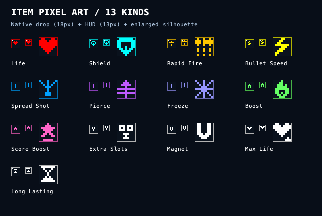

# 아이템 디자인·피드백 구현

담당 범위: 디자인팀 A 손동열. 현재 기준 코드: origin/main `04e9dc5`.
배경·우주선·게임 수치는 기존 구현을 사용한다.

## 변경 사항

- `ItemArtwork`: 13종의 9×9 픽셀 마스크. 바닥 드롭·슬롯·활성 효과·알림·튜토리얼에서 같은 아이콘을 사용한다. 9종 플레이 아이템 외 장비 4종의 그림도 제공하며, 상점 목록 자체는 변경하지 않는다.
- 기존 아이템 색을 유지하되 서로 다른 실루엣으로 구분한다. 네모와 첫 글자를 대체하며 외부 이미지 파일은 필요 없다.
- 550ms 획득 불꽃과 사용 시 확산 효과, 빙결의 눈송이, 활성 Boost의 추진 효과. 기존 방패 표현과 함께 사용한다.
- 최대 3개 알림과 8개 이펙트로 상태를 제한한다. 사용 알림은 오래된 획득 안내보다 먼저 표시하고, 실패 안내는 반복을 제한한다.
- 알림은 효과명·실제 사용 키·간단한 설명을 두 줄로 표시한다. 시간·스택·방어 횟수는 정의 및 실행 상태에서 읽는다.
- 상단 기존 아이템 영역(y=42~59)에 슬롯, 남은 초, 스택 수, 진행 막대를 표시한다. 448px 화면에서 슬롯 4개와 플레이 효과 8종이 함께 들어가며, 좁은 화면에서는 `+`로 추가 효과를 알린다.
- 꽉 찬 보관함에 닿았을 때, 빈 칸을 사용했을 때, 중복 적용이 거절됐을 때 원인을 안내한다. Shield/Boost/Score Boost의 기존 재사용 갱신 정책은 유지한다. Freeze 재사용은 기존 정책대로 거절한다.
- 일시정지 중 알림·효과 시간을 보존하고, 복귀 시 멈춘 벽시계 시간을 버린다. 드롭을 총알보다 먼저 그려 총알이 아이콘 뒤에 가려지지 않게 한다.

`ItemFeedback`은 이벤트 리스너를 사용한다. 화면을 그리는 동안 `drainEvents()`를 호출하지 않아 소리·도전과제 등 다른 소비자에게 전달할 이벤트를 보존한다.

## 로컬 검증 재현

프로젝트 폴더에서 Java 17 이상으로 실행한다. 저장 파일이 클래스 폴더 옆에 생기므로 사용자 데이터와 분리된 임시 폴더를 사용한다.

```sh
check_root=$(mktemp -d /tmp/sdp-item-check.XXXXXX)
mkdir -p "$check_root/classes"
javac --release 17 -Xlint:all -d "$check_root/classes" $(find src tests -name '*.java')
java -Djava.awt.headless=true -cp "$check_root/classes:res" item.ItemVisualFeedbackTest
```

창을 표시할 수 있는 환경에서는 실제 GameScreen 검증 및 PNG 저장도 실행한다.

```sh
java -cp "$check_root/classes:res" item.ItemVisualGameTest "$check_root/screenshots"
```

마지막 인자로 `--hold`를 붙이면 검증 마지막 화면을 45초 유지한다. 이 화면은 실제 게임 렌더러와 실제 아이템 API를 사용하되, 검증을 위해 아이템을 지급한 고정 상태다. 일반 플레이 조작 화면으로 사용하지 않는다.

기존 회귀 검사도 같은 클래스 경로로 실행한다. DashVisualEffectTest, EffectIntegrationTest, FinalBossAttackTest, TwoHitEnemyTest, WeaponUpgradeTest는 headless 모드, GameplayStarfieldTest는 창이 있는 환경을 사용한다. `res`를 클래스 경로에서 빼면 실제 스프라이트 대신 대체 그림이 로딩되므로 리소스 검사 결과가 달라진다.

## 확인 결과와 범위

2026-11-21 리뷰 반영: 최신 main의 아이템 드롭·세로 이동·대시 변경을 병합했다. `beginLevel`의 화면 높이 인자가 빠져 전체 테스트 컴파일이 실패하는 것을 확인하고, 테스트 호출에 높이 520을 전달하도록 수정했다.

CI build 작업은 `src`와 `tests`를 함께 컴파일하고 `ItemVisualFeedbackTest`도 headless 모드로 실행한다. 앞으로 게임 코드와 테스트의 API가 달라지면 CI에서 실패한다.

Java 17 대상 전체 소스·테스트 컴파일과 11개 테스트의 704개 검증 항목이 통과했다. 최신 main에서 들어온 `DashDodgeTest`의 raw `Class` 사용에 대한 기존 경고 12개는 남아 있으며 이번 수정에서 변경하지 않았다. 검증 항목은 DashVisualEffect 61, EffectIntegration 77, FinalBoss 124, TwoHit 166, WeaponUpgrade 44, ShipVerticalMove 17, ShipDash 77, DashDodge 31, ItemVisualFeedback 55, GameplayStarfield 29, ItemVisualGame 23이다.

실제 GameScreen의 렌더링·일시정지 복귀 검사도 디스플레이 환경에서 재실행했다. 아래 화면 예시는 최초 구현 당시 생성한 것이며 새 게임 상태에서도 아이콘·HUD 표시를 확인했다. 키보드로 조작하는 수동 플레이 및 리뷰 승인 여부와는 구분한다.

공유 파일 수정: DrawManager(그리기 연결), GameScreen(일시정지 시계·드롭 순서), TutorialScreen(같은 아이콘과 안내 문구). PR 단계에서 해당 화면 담당자의 리뷰가 필요하다.

## 화면 예시

검증용 아이템 지급 상태에서 실제 게임 렌더러로 출력했다.




