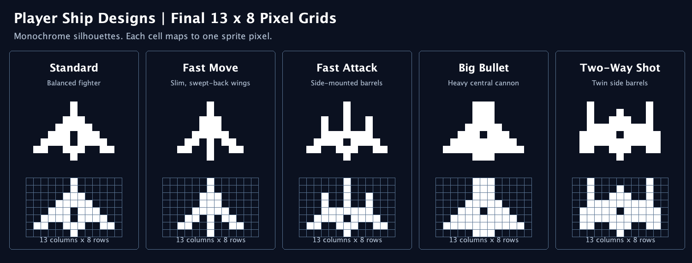

# Player ship sprite redesign (13 × 8)

This change updates the silhouettes of the five **base player ships** while preserving their existing 13 × 8 sprite dimensions (displayed at 26 × 16 pixels in-game).

| Ship | Visual intent |
| --- | --- |
| Standard | Balanced fighter with a clear central fuselage |
| Fast Move | Slim nose and swept-back wings |
| Fast Attack | Distinct side-mounted weapon barrels |
| Big Bullet | Heavy, wide hull with a thick central cannon |
| Two-Way Shot | Two raised, clearly separated side barrels |

The shapes are monochrome so the existing skin/color system continues to work. This change does not alter ship statistics, gameplay logic, movement, shooting, or collision code.

## Pixel grids

`#` means filled, `.` means transparent. Each grid has exactly 13 columns and 8 rows, with the ship pointing up.

### Standard

```text
......#......
......#......
.....###.....
....#####....
...###.###...
..####.####..
.##..###..##.
......#......
```

### Fast Move

```text
......#......
......#......
.....###.....
.....###.....
....#####....
...##.#.##...
..##..#..##..
......#......
```

### Fast Attack

```text
......#......
......#......
...#..#..#...
...#..#..#...
...#######...
..####.####..
.##..###..##.
......#......
```

### Big Bullet

```text
.....###.....
.....###.....
.....###.....
....#####....
...###.###...
..#########..
.###########.
.....###.....
```

### Two Way Shot

```text
..#.......#..
..#...#...#..
..#..###..#..
..#########..
.#####.#####.
.###########.
.##..###..##.
......#......
```

## Reference image



## Implementation notes

- Only the five corresponding sprite bit strings in `res/graphics` are replaced.
- The data format remains **column-major**, top-to-bottom within each column, matching the existing `DrawManager` parser.
- `ShipDestroyed`, alternate ship-shape skins, enemies, and other sprite data remain unchanged.
- The reference image is generated from the same 13 x 8 grids used to validate the column-major sprite data.

## Verification

- Java 17 target compilation passed on JDK 25 with six pre-existing warnings.
- 4,695 checks verified the five loaded sprites, documented grids, white/cyan rendering, and unchanged 26 x 16 collision dimensions.
- Existing standalone regression suites passed 169, 125, and 71 checks.
- Exactly five sprite data lines changed; all other resource entries are unchanged.
